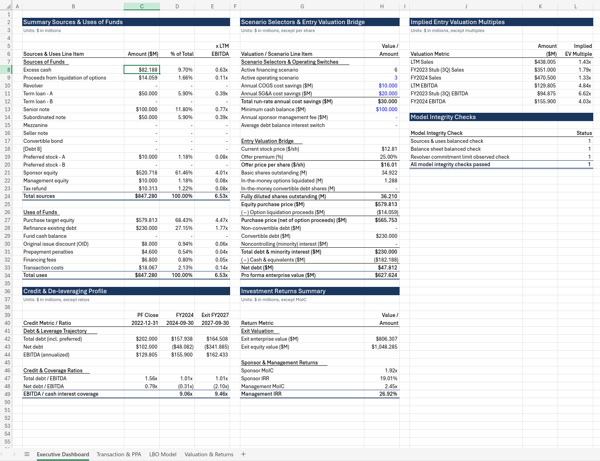
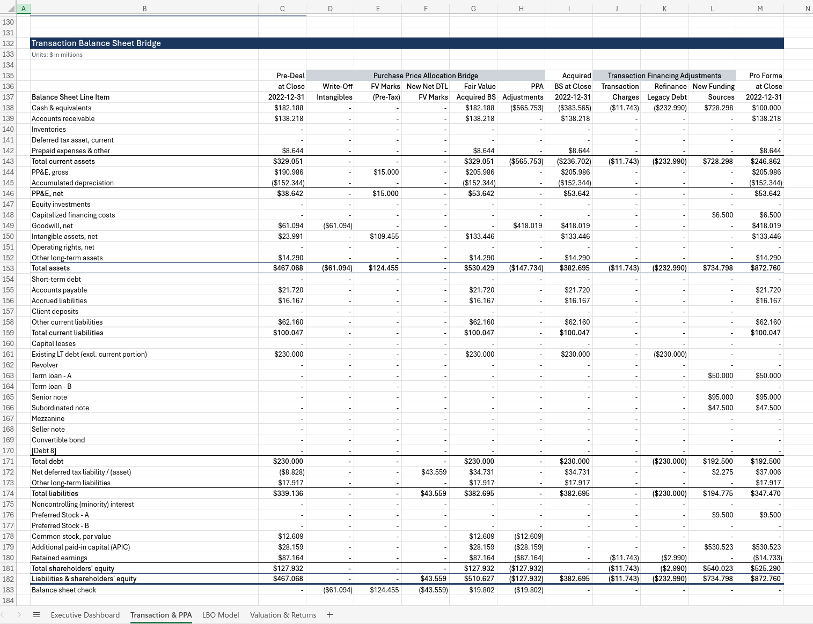

# f8-demo

Financial models built on [`f8-engine`](https://github.com/mhcfa/f8).

This repository serves as a practical showcase for `f8-engine`, a high-performance financial modeling engine that compiles Python code into auditable, live-formula Excel workbooks.

📥 **Direct Download**: [Download compiled `lbo_model.xlsx`](https://github.com/mhcfa/f8-demo/releases/latest/download/lbo_model.xlsx) (ready-to-inspect Excel workbook with live formulas)





## Models

Each model under [`models/`](./models) is a self-contained reference package with its own typed assumptions, declarative schedule builders, and layout specification:

| Package                       | Model         | Description                | Deliverable Command           |
| :---------------------------- | :------------ | :------------------------- | :---------------------------- |
| [`models/lbo/`](./models/lbo) | **LBO Model** | Complete complex LBO model | `uv run python -m models.lbo` |

## Prerequisites

- Python `>=3.12`
- [`uv`](https://github.com/astral-sh/uv) (recommended) or standard `pip`

## Quickstart

Clone the repository and install dependencies:

```bash
git clone https://github.com/mhcfa/f8-demo.git
cd f8-demo
uv sync
```

Run the verification and regression test suite:

```bash
uv run pytest
```

Emit the LBO Excel deliverable (`deliverables/lbo_model.xlsx`):

```bash
uv run python -m models.lbo deliverables/lbo_model.xlsx
```

## Repository Structure

```text
f8-demo/
├── pyproject.toml              # Project dependencies and tool configurations
├── theme.json                  # Shared workbook palette
├── assets/                     # Model preview screenshots
├── deliverables/               # Emitted live-formula .xlsx workbooks
├── models/
│   └── lbo/                    # Self-contained LBO model
│       ├── README.md           # LBO architecture & schedule documentation
│       ├── assumptions/        # Frozen dataclass forward assumptions
│       └── *.py                # Declarative schedule builders
└── tests/
    └── lbo/                    # LBO regression test suite & benchmark fixtures
```

## Disclaimer

This repository, code, and emitted financial models are strictly for educational, illustrative, and demonstration purposes. All figures, valuations, and financial assumptions are entirely hypothetical. Nothing contained in this repository constitutes investment, legal, tax, or financial advice. The author assumes no liability for any actions taken or decisions made based on this material.

## License

This repository is licensed under the [MIT License](./LICENSE).
